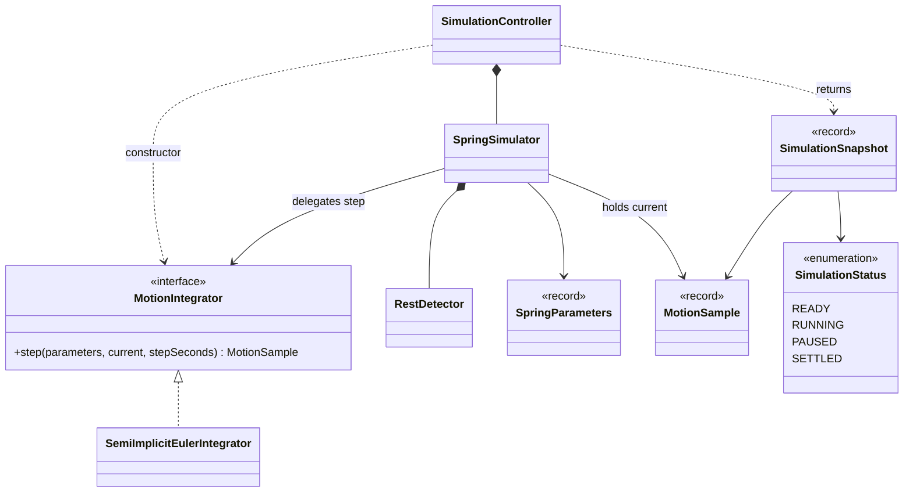

# 设计与类关系

## 项目边界

首版包含一根竖直弹簧和一个重物。可设置弹力系数、相对平衡点的初始位移及摩擦系数。程序支持开始、暂停、继续、复位，显示重物运动及最终状态。位移–时间曲线用于展示两组阻尼的对照实验，在基本动画跑通后接入。

## 模块

| 路径 | 技术 | 职责 |
|---|---|---|
| `simulation-core/src/main/java` | Java 21 | 参数、数值积分、静止检测、状态切换。仿真时钟按固定步长推进 |
| `simulation-core/src/test/java` | JUnit 4 | 直接验证 Java 计算和状态切换 |
| `desktopApp/src/main/kotlin` | Kotlin/JVM、Compose Desktop | 输入和提示、绘制弹簧、帧计时与曲线 |
| `docs` | Markdown | 设计、接口、开发和验收 |

Java 的基础包名为 `io.github.chenglei6arch.springmotionlab.simulation`，源码按职责放在三个子包。

| 子包 | 主要类型 | 职责 |
|---|---|---|
| `model` | `SpringParameters`、`MotionSample` | 保存本轮参数和各时刻的运动数据 |
| `engine` | `MotionIntegrator`、`SemiImplicitEulerIntegrator`、`SpringSimulator`、`RestDetector` | 负责单步积分、查验静止和保存当前运动采样 |
| `control` | `SimulationController`、`SimulationStatus`、`SimulationSnapshot` | 处理开始、暂停、继续、复位并向界面提供快照 |

桌面界面依赖 `control` 与 `model`。`control` 调用 `engine`，两者从 `model` 读取数据。Java 核心可以在无界面的环境中测试，测试包与被测代码对应。

## Java 类型关系



- `SemiImplicitEulerIntegrator` 实现 `MotionIntegrator`。接口只约定如何从一个采样推进到下一个采样，方便将来换数值算法，也方便测试注入可预测的实现。
- `SpringSimulator` 组合积分器和静止检测器，保存本次仿真的当前采样。
- `SimulationController` 负责生命周期并对外提供快照。每次复位新建一个模拟器，旧的采样和连续静止计数随之清除。
- 参数、采样和快照用 Java record 表达，方便跨 Java/Kotlin 传递不可变数据。当前类关系以接口实现和组合为主。

## 物理模型

各量采用 SI 单位。固定质量 `m = 1.0 kg`，从给定位置静止释放。正方向向下，`x = 0` 取挂上重物后的静态平衡位置，重力与该位置的弹簧拉力已经抵消。界面上的摩擦系数采用与速度成正比的阻尼 `c`。

```text
a     = (-k * x - c * v) / m
vNext = v + a * dt
xNext = x + vNext * dt
dt    = 1 / 每秒仿真步数
```

先更新速度再用新速度更新位移。Java 每次推进一个固定步长，Compose 只根据帧时间安排推进次数。用模拟时间绘制曲线，同一组参数可以复现实验。[弹簧与阻尼模型参考](https://www.myphysicslab.com/springs/single-spring-en.html)

## 参数与常量的归属

| 值 | 源码位置 | 使用方式 |
|---|---|---|
| 弹力系数、初始位移、摩擦系数 | `model/SpringParameters.java` | 由用户输入，界面初值读取 `defaults()`。取值范围和默认值集中在这个类 |
| 固定质量 | `model/SpringParameters.java` | 模型约定使用 1 kg，积分器读取 `MASS_KILOGRAMS` |
| 仿真频率 | `engine/SpringSimulator.java` | 每秒 120 步，步长由频率计算，界面从 `controller.stepSeconds()` 读取 |
| 静止判定 | `engine/RestDetector.java` | 位移绝对值小于 0.002 m，速度绝对值小于 0.005 m/s，两个条件持续至少 400 毫秒 |

静止判定所需步数按持续时长与每秒步数换算并向上取整，当前设置算出 48 步。修改频率时会自动重新换算。经过平衡点时速度可能较大，经过转折点时位移可能较大，两种情况都要继续计算。达到静止条件后保留最后一次采样。
